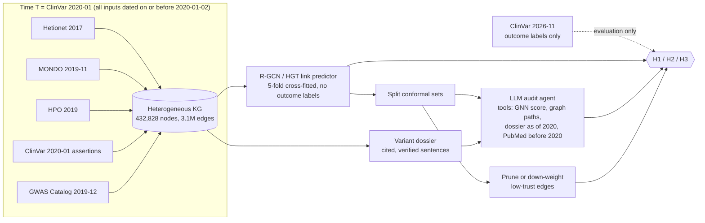

# Hindsight (kg-gc): which genotype-phenotype knowledge graph edges will be revised?

Genotype-phenotype knowledge graphs treat every edge as equally true, but variant-disease assertions get revised. ClinVar publishes monthly archives, so we can build a knowledge graph exactly as it stood in **January 2020**, and check against the **November 2026** release which of its edges were later downgraded (pathogenic or likely pathogenic to uncertain, conflicting or benign) or upgraded (uncertain to pathogenic). That gives a real, prospective ground truth for knowledge-graph "garbage" with no manual labelling. We use it to test three hypotheses with a strict no-leakage protocol: (H1) a heterogeneous GNN trained on the 2020 graph scores the edges that were later revised as less plausible than simple baselines do; (H2) an LLM agent that combines GNN scores with time-restricted evidence retrieval audits edges better than either alone; (H3) cleaning low-trust edges improves downstream link prediction. **Results: H1 is supported for upgrades but not for downgrades, and simple neighbourhood counts capture most of the graph signal; H2 and H3 are not supported.** The repository also contains a fully cited per-variant evidence dossier (the QIAGEN problem) whose every sentence is machine-verified against a stored source record.

Built for Nucleate Pittsburgh BioHack 2026: NVIDIA problem ("agentic frameworks that leverage GNNs to parse phenotype-genotype knowledge graphs") and QIAGEN problem ("mine and reconcile public data for a list of SNPs into cited plain-text summaries").

All numbers below are copied from `results/tables.md`, which `scripts/m8_tables.py` generates from files in `results/`. Running log of decisions and failures: [NOTES.md](NOTES.md). Related work: [docs/related_work.md](docs/related_work.md).

## Method



* **Leakage control.** Every node and edge type records its source; a test fails if any source is released after T, is flagged leaky (PrimeKG, gnomAD v4, ClinVar 2026), or if any ClinVar or GWAS date is after T. We use Hetionet (2017) instead of PrimeKG (built from 2021 sources) as the molecular background for the temporal experiment. The GNN never sees outcome labels. LLM weights postdate T and may remember later reclassifications; tool evidence is restricted to T, but this residual leak cannot be removed and would favour the agent.
* **Labels (M1).** Germline, exact P/LP or VUS at T, single condition mapped to one MONDO 2019 term, single gene; outcome from the archived 2026-11 release.
* **GNN (M3).** R-GCN and HGT on the full graph (full batch on CPU). Cross-fitting: each edge is scored by a model that never saw that variant's assertion; assertion edges only point variant to disease, so a variant never receives a message carrying its own class. Trained to separate time-T P/LP from B/LB edges and random corruptions.
* **Baselines.** ClinVar review stars, submitter count, conflict history before T, gnomAD v2.1.1 allele frequency, CADD (version not verifiable, reported separately), and gradient-boosted models over these (gene-grouped cross-validation on outcomes; plus a prospective model fitted only on 2018 to 2020 revisions).

## Results

### M1. Labels (ClinVar 2020-01 versus 2026-11)

| class | n |
|---|---|
| downgraded (P/LP at T, VUS/conflicting/B/LB in 2026) | 4,170 |
| stable pathogenic | 50,722 |
| upgraded (VUS at T, P/LP in 2026) | 2,131 |
| stable VUS | 71,361 |

Downgrade rate among P/LP 7.6%, upgrade rate among VUS 2.9%.

### H1. Does the GNN find the edges that were later revised? (AUROC, 95% bootstrap CI)

| method | downgrade (4,170 of 54,892) | upgrade (2,131 of 73,492) |
|---|---|---|
| review stars | 0.610 (0.603 to 0.617) | 0.432 (0.423 to 0.441) |
| gnomAD v2.1.1 AF | 0.660 (0.652 to 0.668) | 0.628 (0.619 to 0.636) |
| CADD (version unverified) | 0.677 (0.667 to 0.687) | 0.724 (0.715 to 0.734) |
| **R-GCN score alone (no outcome labels)** | 0.723 (0.715 to 0.730) | 0.819 (0.811 to 0.827) |
| HGT score alone (undertrained, 24 epochs) | 0.683 (0.676 to 0.691) | 0.703 (0.693 to 0.714) |
| GBM, prospective (fit on 2018 to 2020 revisions) | 0.816 (0.811 to 0.823) | 0.746 (0.734 to 0.756) |
| GBM tabular (gene-grouped CV) | 0.837 (0.831 to 0.842) | 0.812 (0.804 to 0.820) |
| GBM tabular + R-GCN | 0.839 (0.833 to 0.845) | 0.882 (0.875 to 0.888) |
| GBM tabular + neighbour counts | 0.848 (0.842 to 0.854) | 0.895 (0.889 to 0.901) |
| GBM tabular + neighbour counts + R-GCN | 0.844 (0.838 to 0.850) | 0.899 (0.893 to 0.905) |

Paired bootstrap, does the graph add signal (AUROC delta):

| task | comparison | delta (95% CI) |
|---|---|---|
| downgrade | tabular to tabular + R-GCN | +0.002 (-0.000 to +0.005), not significant |
| downgrade | tabular + neighbour counts to + R-GCN | -0.004 (-0.006 to -0.002) |
| upgrade | tabular to tabular + R-GCN | +0.070 (+0.063 to +0.077) |
| upgrade | tabular + neighbour counts to + R-GCN | +0.004 (+0.002 to +0.006) |

**Reading.** For downgrades, the GNN adds nothing beyond ClinVar metadata that curators already see or that the variant itself shows (in permutation importance missense consequence is the largest feature, followed by review stars, gnomAD frequency and likely versus definite pathogenic). For upgrades, graph context matters a lot (+0.070 AUROC), but leave-one-out counts of other variants in the same gene and disease capture almost all of it; the GNN adds a small residual +0.004. The R-GCN alone, trained without any outcome labels, matches the supervised tabular model for upgrades. Held-out time-T link prediction is strong (P/LP versus B/LB AUROC 0.978 to 0.981 across folds), and split conformal sets reach their nominal 90% coverage (0.901 for both classes). Full tables, stratification by review stars and HGNC gene group, and feature importance: `results/m3/`.

### H2. Does an LLM audit agent beat the GNN? (320 edges, 80 per outcome)

Model `nvidia/Nemotron-3_5-Lightning` (reasoning off) via Nebius Token Factory; truth from 2026 ClinVar; evidence restricted to T. Accuracy counts `needs_review` as wrong.

| config | accuracy | macro-F1 | coverage | ECE | tool calls / edge |
|---|---|---|---|---|---|
| (a) GNN only, conformal rule | **0.550** | **0.516** | 0.822 | 0.350 | 0 |
| always answer "keep" (trivial baseline) | 0.500 | 0.222 | 1.000 | n/a | 0 |
| LLM alone, no tools | 0.306 | 0.308 | 0.578 | 0.501 | 0 |
| (b) agent without GNN tools | 0.297 | 0.303 | 0.544 | 0.507 | 5.86 |
| (c) agent with GNN tools | 0.294 | 0.316 | 0.553 | 0.521 | 6.00 |
| (d) agent with GNN tools + conformal budget | 0.328 | 0.372 | 0.619 | 0.485 | 5.93 |

The GNN-only rule scores above every agent (agent minus GNN macro-F1 -0.14 to -0.21, all p < 0.001, paired bootstrap), but it is not a strong auditor. Always answering "keep" scores accuracy 0.500 and macro-F1 0.222 on this sample, so the GNN rule's accuracy gain over it is not significant (+0.050, 95% CI -0.022 to +0.119); its macro-F1 gain is (+0.294, CI +0.239 to +0.343) and comes mainly from upgrades (62 of 80 caught, 21 of 80 stable VUS wrongly upgraded). It caught only 6 of 80 downgrades. Agents downgrade almost every pathogenic edge (recall 0.89 to 0.99, precision 0.50 to 0.51, which is chance on this balanced sample) and rarely upgrade. Giving the agent GNN tools does not help by itself (b to c: +0.013 macro-F1, p = 0.64); spending tool calls according to conformal uncertainty does (c to d: +0.056, CI +0.011 to +0.104, p = 0.017), at matched mean tool calls. It also used 65% more prompt tokens, and it is one of 18 uncorrected comparisons, so we treat it as suggestive. **H2 is not supported.** Token cost for the whole evaluation was about 26M input and 0.6M output tokens (about $1.70 at the listed price). Traces: `results/m5/`.

### H3. Does cleaning help downstream? (gene-disease link prediction, 8,122 pairs that first appear in 2026)

| arm (3 seeds) | edges removed | AUROC mean (sd) | AUPRC mean (sd) |
|---|---|---|---|
| original graph | 0 | 0.911 (0.003) | 0.651 (0.005) |
| prune GNN-flagged edges | 3,908 | 0.889 (0.010) | 0.579 (0.021) |
| down-weight GNN-flagged edges | 3,908 | 0.906 (0.006) | 0.625 (0.006) |
| prune by prospective GBM | 3,908 | 0.905 (0.003) | 0.636 (0.009) |
| prune random edges | 3,908 | 0.908 (0.002) | 0.641 (0.006) |
| prune the edges really downgraded (oracle, uses future labels) | 4,170 | 0.908 (0.004) | 0.638 (0.003) |

**H3 is not supported.** No arm improves prediction of new gene-disease links; even removing exactly the edges that were later downgraded does not help. One plausible reason, not tested directly, is that a downgraded variant often sits in a gene that still causes the disease, so the edge still carries gene-level signal. The STaRK-Prime graph-RAG part of H3 was **not run** (needs a GPU for G-Retriever fine-tuning). Preparation shows our trust signal reaches only 5,326 of 80,411 PrimeKG disease-protein edges (6.6%), which bounds any effect there.

### QIAGEN problem: cited variant dossiers

`kggc-dossier --rsids rs334,rs429358 --as-of latest --out out/` gathers dbSNP (merge history, alleles), Ensembl VEP, gnomAD v2.1.1 and v4.1 (per ancestry), dated ClinVar assertions and submission history, CIViC and COSMIC identifiers, GWAS Catalog and LitVar2/PubMed literature; reconciles conflicts (pathogenic claim versus ACMG BA1 frequency, submitter disagreement, allele-specific classifications, discordant gene names); and writes JSON plus plain text where **every sentence carries a citation that a verifier re-checks against the stored raw record**. `--as-of 2020-01-01` restricts every source to that date. Sentences are generated from templates, not by an LLM, so they cannot state a fact missing from their record.

| set | complete | sentences | citations | citation validity |
|---|---|---|---|---|
| QIAGEN 20 (latest) | 20/20 | 656 | 1,828 | 1.000 |
| QIAGEN 20 (as of 2020-01-01) | 20/20 | 479 | 1,216 | 1.000 |
| 100 ClinVar expert-panel + 100 GWAS lead SNPs | 200/200 | see `results/m4_broad/summary.json` | | 1.000 |

The 20 official variants are in [results/qiagen_20/](results/qiagen_20/) with a combined [qiagen_20_report.md](results/qiagen_20/qiagen_20_report.md). Handled automatically: multi-allelic sites (rs334, rs121913529, rs6025 reported per allele), indels (rs113993960, rs80357713), retired IDs (rs80357713 now rs80357783), somatic hotspots (KRAS G12, TP53 R175H via ClinVar oncogenicity, CIViC and COSMIC IDs), population differentiation flags (rs334, rs1426654, rs3827760), traits without disease relevance (rs713598, rs12913832), and the APOE haplotype (rs429358 + rs7412 detected from literature co-occurrence and abstracts, with a joint interpretation). Conflict recall against ClinVar's conflicting flag: 1.00 (n = 100), computed from individual submissions only. Caveat: 100% citation validity shows the verifier finds nothing broken; it does not measure whether the evidence chosen is complete.

### Case study: COPD and emphysema

See [docs/case_study_copd.md](docs/case_study_copd.md) and `results/m7/copd_subgraph.png`. Only 12 time-T ClinVar edges are COPD-related; all 3 that were later downgraded had an empty GNN conformal set at T. The audit agent (config c) flagged all 10 pathogenic edges as downgrades (accuracy 3 of 12), repeating its M5 failure mode. SERPINA1 drops out under the time-T rule because its COPD GWAS support in the catalog dates from 2024.

## Limitations

* The outcome is ClinVar's own later view, not biological truth; "downgraded" includes edges that became conflicting because a new submitter disagreed.
* Labels use the variant-level aggregate classification in 2026, not per-condition classifications.
* Disease-phenotype HPO annotations from before 2020 are not available in complete form (archived copies are truncated), so the graph has gene-phenotype but not disease-phenotype edges.
* HGT is undertrained (24 CPU epochs); neighbour-sampled and cuGraph training paths were not run (no GPU; `pyg-lib` has no wheel for the development machine).
* The agent uses one small model with reasoning off; a stronger model might do better, and its pretraining postdates T.
* The STaRK-Prime G-Retriever experiment (M6 part 2) was not run.
* GPU hours used: 0.

## Reproduce

```bash
make install            # Python 3.12 venv with uv
make data               # pinned downloads, md5-checked (about 2 GB)
make reproduce-small    # CPU, subsampled graph; 7.5 min on a laptop (see Makefile)
make reproduce          # everything (CPU; M5 needs NEBIUS_API_KEY or NVIDIA_API_KEY, or the response cache)
make test
```

The LLM provider is configured with `KGGC_LLM_BASE_URL`, `KGGC_LLM_MODEL` and `KGGC_LLM_API_KEY_ENV` (the name of the variable that holds the key); keys are read only from the environment. Every API response is cached in `data/cache/` with timestamp and source version; seeds are fixed.

## Data sources and licences

ClinVar (public domain, NCBI); Hetionet v1.0 (CC0; some underlying sources have their own terms); MONDO (CC BY 4.0); Human Phenotype Ontology (HPO licence, free for research with attribution); NHGRI-EBI GWAS Catalog (CC0 / EBI terms of use); gnomAD (ODbL); Ensembl, dbSNP, PubMed, LitVar2 (public); CIViC (CC0); PrimeKG (CC BY 4.0). Only public, summary-level data are used; no controlled-access cohort data.

## Citation

See [CITATION.cff](CITATION.cff). Code under the MIT licence.
